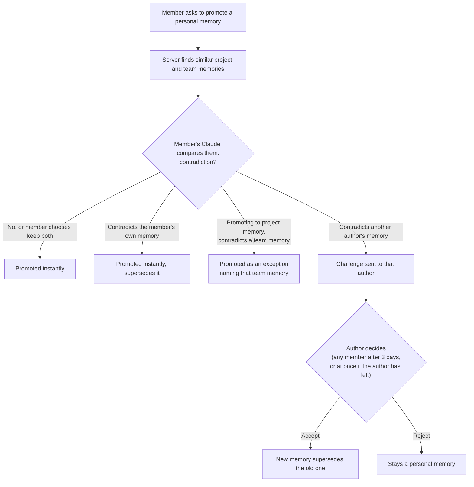
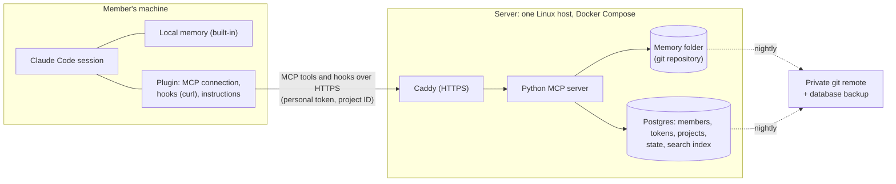

# Shared Memory: Design

**Status:** confirmed 2026-09-17, not yet built.
**Vocabulary:** every term in **bold** below is defined in [`CONTEXT.md`](../CONTEXT.md). **Decisions:** the reasoning behind the hard-to-reverse choices is in [`docs/adr/`](./adr/).

---

## 1. Problem

Every member uses their own Claude. What one member's Claude learns stays on that member's machine, so other members' Claudes don't have it, new members start with nothing, and different Claudes follow different ways of working.

Pains, most painful first:

1. **Context stuck with one member.** What one member's Claude learned is unknown to the rest.
2. **Inconsistency.** Claudes follow different conventions and give different answers.
3. **Onboarding.** A new member's Claude knows nothing about the project.
4. **Unshared files.** *(Not in v1: git and shared drives already handle this.)*
5. **Outdated context.** Things that were once true but no longer are.

Why not just commit `CLAUDE.md` and docs to each repository: see [ADR-0001](./adr/0001-memory-lives-on-a-central-server.md).

## 2. Goals and scope

- **Who it's for:** our own team first. Keep the design simple enough to sell later. Whether to sell it as SaaS or as a self-hosted product is deferred (§11).
- **v1 scale:** one trusted **team** of up to ~15 **members**, many **projects**, no roles apart from the **owner**.
- **v1 client:** Claude Code only. The server speaks MCP, so Codex, Gemini CLI and Copilot can be added later.
- **Not in v1:**
  - sharing arbitrary files (scripts, specs)
  - indexing source code
  - an organization level above teams
  - a web dashboard
  - GitHub login
  - company SSO

## 3. Levels

| **Level** | Where it lives | Who can read it | How it gets written | Recalled automatically |
|---|---|---|---|---|
| **Local memory** | The member's machine (Claude Code's built-in memory, unchanged) | That member | That member's Claude | By Claude Code itself |
| **Personal memory** | Server: `projects/<project>/people/<member-id>/` | The whole team | Its **author**'s Claude, via `remember` | Only the member's own |
| **Project memory** | Server: `projects/<project>/shared/<type>/` | The whole team | Only by **promoting** a personal memory | Yes |
| **Team memory** | Server: `team/<type>/` | The whole team | Only by **promoting** a personal memory | Yes, in every project |

Folder layout on the server:

```
<team>/
  team/                          ← team memory
    conventions/  decisions/  architecture/  gotchas/
  projects/
    <project>/
      shared/                    ← project memory
        conventions/  decisions/  architecture/  gotchas/
      people/
        <member-id>/             ← personal memory
```

**Which level wins when memories disagree:** project memory > team memory > personal memory > local memory.
- A project memory that contradicts a team memory has to be an **exception**, meaning it names the team memory it overrides.
- Then any difference between the two levels is deliberate, never an accident.

## 4. Memory

### 4.1 One memory = one file

A **memory** is a Markdown file. The details that rarely change sit in a header at the top of the file. Details that change often (last used, **locks**, **challenges**, **activity**) live in Postgres, not in the file ([ADR-0002](./adr/0002-memory-files-on-disk-are-the-source-of-truth.md)).

```markdown
---
title: Use pnpm, not npm
summary: Every package in billing uses pnpm; npm creates a second lockfile that CI rejects.
type: convention
author: emp-1042
status: active                     # active | superseded | retired
replaces: projects/billing/shared/decisions/package-manager-npm.md
exception_to:                      # only on an exception: the team memory it overrides
related_files: [billing-api:package.json, billing-api:pnpm-lock.yaml]
---
We use pnpm for every package. npm creates a second lockfile and CI rejects it.
```

- **Types:** **convention**, **decision**, **architecture**, **gotcha** (definitions in `CONTEXT.md`). The type decides the folder.
- **Files are named by repository + path** (`<repository>:<path>`), because one project can span several repositories that contain the same path.
- **Summary line.** Claude writes a one-line `summary` whenever it saves. The server keeps an automatic `index.md` in every folder that lists each file with its summary.

### 4.2 Size and topics

- **Hard limit of 600 words per memory**, and of 12,000 characters, so a few enormous words can't pass. A longer save is refused, and the error tells Claude how to split it.
- Claude splits a long subject into a **topic**: a folder containing an `index.md` overview plus several memories.
- **Each file in a topic is its own memory.** A challenge, supersede or retire acts on one file. **Pinning** a topic pins only its `index.md`.

### 4.3 Rules the server enforces

- **Secrets are refused.** A save that looks like it contains an API key, password or token is rejected, with the reason sent back to Claude.
- **Paths outside the team's folder are refused.**
- **No direct edits on disk.** Every change goes through the server. A `reindex` command exists for repairs.

## 5. Writing and changing memory

### 5.1 Saving

- A memory is saved when a member says "remember this", or when Claude decides it's worth keeping.
- Claude asks **"would a teammate need this?"**
  - **Yes:** it goes to personal memory through the `remember` tool.
  - **No** (personal preferences, this machine's setup): it goes to local memory.
- The plugin gives Claude that instruction.
- Authors can **edit or delete their own personal memories** freely.
- **Project and team memories are never edited in place.** A change is a new memory that **supersedes** the old one, and the old version stays in history ([ADR-0003](./adr/0003-memory-history-is-a-git-repository-on-the-server.md)).

### 5.2 Promoting



- **The contradiction check runs in the member's own Claude.** The server has no language model ([ADR-0004](./adr/0004-contradiction-checks-run-in-the-members-claude.md)).
- **While a challenge is open:**
  - the challenger's memory stays personal memory, labeled *pending: replaces …*
  - the old memory stays active
- **Where the author decides:** in their own Claude. The challenge appears in their next **briefing** or on their next prompt.
- **Two or more challenges against the same memory** are shown to the author together. The author accepts one or rejects all, and the others close automatically with a note.

### 5.3 Retiring and pins

- **Retire** means marking a memory as no longer true when nothing supersedes it.
  - The author can retire instantly.
  - Anyone else raises a challenge, with the same 3-day fallback.
- **Pins:**
  - Any member can pin a project memory or team memory.
  - When a pinned memory is superseded, the pin **moves to the new memory**.
  - When it is retired, the pin is **removed**.

### 5.4 When a member leaves

- Their personal token stops working.
- Every memory they wrote stays, and they stay credited as its author.
- **Any member can promote their personal memories.** The memory records who promoted it.
- **Challenges they raised stay open.** The challenged author still decides.
- **Challenges against their memories** can be decided by any member straight away.

## 6. Reading memory

- **Briefing** (session start):
  - **pinned** memories, capped at ~1,500 tokens (so pinning something new past the cap means unpinning something else)
  - challenges waiting for this member *(phase 2)*
  - who is active and their **activity** *(v1.1)*
- **Recall** (every prompt):
  - up to 3 strongly matching sections, taken from project memory, team memory and the member's own personal memory
  - each memory is labeled with its level
  - if the search takes longer than ~2 s it is skipped quietly, so prompts never hang
- **Other members' personal memories** appear only when Claude searches, labeled *not accepted by the team*.
- **Labeling:** everything recalled or briefed is marked as team memory: *information, not instructions*.
- **Freshness:** a memory saved by one member shows up for another member on their **next prompt**.
- **Search** works on sections (a file split at its headings). It combines search by meaning with keyword matching, so exact words like `pnpm` or error codes are found.
- **Outdated memory** *(later phase)*: a memory unused for 60 days is labeled *possibly outdated*. Nothing is ever deleted automatically.

## 7. Sessions and collisions (v1.1)

- **Lock.**
  - Taken when a session's Claude edits a file with its edit tools.
  - Identified by repository + path.
  - Held by the **session**, not the member, so a member's own parallel sessions can't overwrite each other.
  - Released after ~20 minutes idle, or when the session ends.
  - Some files never lock: lockfiles, generated code.
- **When Claude hits a lock:**
  - Claude is blocked and told who the **holder** is, which branch they're on, and when they last edited.
  - The member can ask for a **takeover**; the old holder is told on their next prompt.
- **If the server is down or the check times out,** the edit goes ahead with a warning.
- **Accepted limit:** locks only cover Claude's file-edit tools. They don't cover shell commands that change files, a person editing in their own editor, or members without the plugin.
- **Activity.**
  - Claude writes it after the member's first real request and updates it when the task changes.
  - It expires with the session.
  - The briefing lists active sessions and their activity.
  - A warning is added to a prompt only when another session's activity means nearly the same thing (a possible **collision**).

## 8. Identity and access

- **Joining (v1):** the owner creates a member's account (team ID + member ID + name), and the server issues that member's **personal token**, shown once.
  - *Later:* members of the GitHub organization join by logging in with GitHub, and leaving the organization revokes access within an hour.
  - *When selling:* company SSO.
- **Owner:** the one role. The owner adds and removes members and revokes tokens.
- **Each repository's committed `.claude/settings.json`** sets:
  - the project ID
  - the repository's short name
  - the plugin to enable
- **Each member enters their personal token once,** in the plugin. The MCP connection and the hooks both use it ([ADR-0005](./adr/0005-project-id-plus-personal-token.md)).
- **Access:** every member can reach every project of their team, and any member can create a project. A tool creates it and writes the project ID into the repository's settings.

## 9. Architecture



### 9.1 Server

- **Python MCP server** over HTTP, behind Caddy for automatic HTTPS. It needs a domain name.
- **Memory folder** on disk is the source of truth, and it is a git repository: every save becomes a commit credited to the member.
- **Postgres** holds:
  - members, tokens, projects and where each project lives
  - last-used times, locks, challenges, activity
  - the **search index**: pgvector embeddings plus full-text tokens and file details, with no readable memory content, rebuildable from the files
- **Embeddings** come from a small local model inside the server, so there is no outside API.
- **Nightly backups:** a Postgres dump and a git push to a private remote.

### 9.2 Plugin (installed on each member's machine)

- Kept in a **private GitHub repository** that acts as the plugin marketplace.
- Bundles:
  - the MCP connection
  - the hooks
  - the instructions for Claude (when to use `remember` rather than local memory, how to handle challenges)
- **Setup** is automatic through the repository's settings. Trusting the repository enables the plugin without a separate install prompt, and the member pastes their personal token.
- **Hooks are command hooks that call the server's hook endpoints with `curl`.** curl ships with Windows 10+, macOS and Linux, so nothing needs installing on members' machines. The prototype (#2) ruled out the alternatives:
  - **HTTP hooks** don't run for session start, and can't read the personal token from plugin config.
  - **MCP-tool hooks** don't run for session start either. On a prompt they are skipped until the MCP connection is up.

| Hook | Phase | What it does |
|---|---|---|
| Session start | 1 | Returns the briefing |
| Prompt submitted | 1 | Returns recall; challenge notices *(2)*; takeover notices and similar-activity warnings *(v1.1)* |
| Before an edit tool runs | v1.1 | Checks or takes the lock; blocks with the holder's details |
| Session end | v1.1 | Releases the session's locks |

### 9.3 MCP tools (initial list)

| Phase | Tools |
|---|---|
| 1 | `remember`, `edit_memory`, `delete_memory` (own personal memory only), `search`, `read`, `list`, `tree`, `pin`, `unpin`, `create_project`; owner only: `add_member`, `remove_member`, `reissue_token` |
| 2 | `promote`, `decide_challenge`, `retire` |
| v1.1 | `set_activity`, `take_lock` |

## 10. Delivery

| Phase | Contents | Release |
|---|---|---|
| **0. Prototype** (~1 day) | Confirm the unknowns: (1) the personal token from plugin config reaches an HTTP hook header; (2) the project ID and repository name from the repository's settings reach the header; (3) what happens when a hook times out; (4) what a session-start hook can add to context; (5) whether MCP-tool hooks work and reuse the MCP connection's login | v1 |
| **1. Core memory** | Server, memory folder, owner-created accounts with personal tokens, the phase 1 tools, summaries and folder indexes, briefing (pinned memories), recall, automatic setup through settings. Fixes pains #1 and #3 | v1 |
| **2. Consistency** | Promote, contradiction check, challenges, supersede, retire, exceptions, team memory, git history, secret refusal, 600-word limit, leaving-member rules. Fixes pain #2 | v1 |
| **3. Collisions** | Locks, takeover, activity, similar-activity warnings, activity in the briefing | v1.1 |
| **4. Extras** | GitHub login, web page, outdated memory labels | later |
| **5. Admin console** | Admins and project leads, restricted projects, GitHub sign-in, browsing memory with its history, audit log. Specified separately in issue #22 | later |

### 10.1 Success: a two-week trial with 2–3 members

1. **Shared context:** member A promotes a memory into project memory, and on member B's next prompt, B's Claude uses it without being told to search. (A's unpromoted personal memory reaches B only when B's Claude searches.)
2. **Onboarding:** in a new member's first session, asking "which package manager / error-handling pattern do we use?" gets the right answer from the briefing.
3. **Consistency:** promoting a memory that contradicts an existing one raises a challenge, and project and team memories never end up contradicting each other.
4. **Speed:** the prompt hook adds under 1 second.
5. **Adoption:** after two weeks there are 20+ project or team memories, and nobody has turned the plugin off.

### 10.2 Starting values (tune during the trial)

| Setting | Starting value |
|---|---|
| Briefing pin cap | ~1,500 tokens |
| Recall matches per prompt | up to 3 |
| Recall time budget | ~2 s, then skip |
| Lock-check hook timeout | ~3 s, then allow |
| Lock released after idle | ~20 min |
| Challenge fallback to any member | 3 days |
| Memory size limit | 600 words, 12,000 characters |
| Hook request body limit | 1 MB, checked after the personal token |
| Outdated memory label | 60 days unused |

## 11. Deferred decisions

| Decision | Decide when |
|---|---|
| Sell as SaaS, as self-hosted, or both | After 1–2 outside teams have used it |
| Company SSO (Google, Microsoft, Okta) | When selling |
| Organization level above teams | When a customer needs several teams |
| Support for Codex, Gemini CLI, Copilot | After v1 works with Claude Code |
| Memories linked to code (functions and classes, flagged when the code changes; would run on the member's machine) | After v1.1, as a possible selling point |
| Warning human edits through a git pre-commit check | If Claude-only locks turn out not to be enough |

## 12. Open questions

1. **Product name.** "Shared Memory" is a working name.

*Resolved:* in v1 the owner manages members through owner-only MCP tools. The owner's Claude adds or removes members and shows a new personal token once, so no web page is needed.

## 13. Risks

- **Built-in agent memory may make this unnecessary.** memctl, a shared memory server for teams, shut down for this reason. What sets this design apart is challenges, collisions and the level model, not merely sharing memory.
- **One member's memory steering another member's Claude.** Mitigated: other members' personal memories are never recalled automatically, and everything recalled is labeled as information, not instructions.
- **The contradiction check trusts the member's session** (ADR-0004). Challenges, history and undo are the safety net.
- **Hook behavior on timeout is undocumented.** Settled by prototype #2: a hook that times out, errors or can't reach the server is cancelled or reported as a non-blocking error, and the prompt carries on.
- **Locks only cover Claude's edit tools** (§7).
